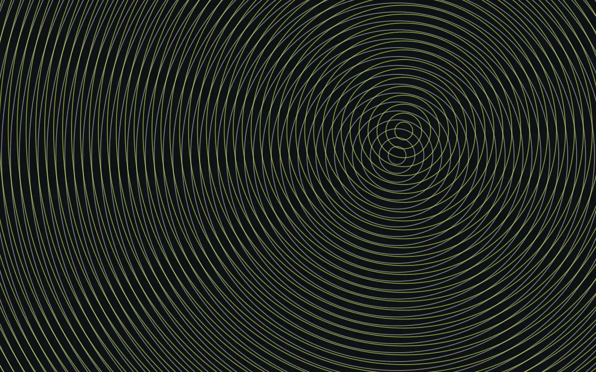

旧的东西已经全部删掉了。这是新站的第一篇文章，也是一份写作样例：下面的每一种格式，写新文章时都可以直接照抄。

## 写作

文章放在 `src/content/posts/` 下，文件名就是网址。普通的 Markdown 都能用：**加粗**、*强调*、`行内代码`、[链接](https://astro.build)，还有脚注[^1]。在宽屏上，脚注会变成右侧页边的[旁注](/posts/sidenotes/)，读的时候不用跳到文末[^2]。

指向站内文章或实验的链接，比如[每篇文章一张生成封面](/posts/generative-covers/)或者[莫尔纹实验](/lab/moire/)，鼠标停一下会浮出一张预览卡片。

> 引用块适合放别人的话，或者自己当时的想法。

- 无序列表
- 第二项
  - 可以嵌套

1. 有序列表
2. 第二项

| 语法 | 用途 |
| --- | --- |
| `.md` | 纯文字文章 |
| `.mdx` | 需要嵌入组件的文章 |

## 图片

图片的标题会变成带编号的图注，点击图片可以放大查看。



## 代码

代码块会按亮/暗主题自动切换配色，右上角有复制按钮。在语言后面写 `title="文件名"` 会显示文件名标题栏，`{行号}` 会高亮对应的行。

```ts title="src/lib/particle.ts" {7-8}
// 一个最小的粒子：位置 + 年龄
interface Particle {
  x: number;
  y: number;
  age: number;
}

function step(p: Particle, angle: number, speed = 1.2): Particle {
  return { x: p.x + Math.cos(angle) * speed, y: p.y + Math.sin(angle) * speed, age: p.age + 1 };
}
```

改动可以用 diff 标注：

```ts title="astro.config.ts"
export default defineConfig({
  site: 'https://example.com', // [!code --]
  site: 'https://elvhack.com', // [!code ++]
  integrations: [mdx(), sitemap()],
});
```

## 实验

`.mdx` 文章里可以直接放交互组件。下面是两路正弦信号：叠加模式看合成波形，切到李萨如模式看两者的相位关系。拖一拖滑块。

<Experiment title="双正弦示波器" note="试试频率 3 : 2、相位 90°，再切到李萨如模式。">
  <SignalScope f1={3} f2={2} phase={90} />
</Experiment>

<Callout type="tip" title="写自己的实验">
  在 `src/components/mdx/` 里新建一个组件，然后在 `src/pages/posts/[...slug].astro` 的 `components` 里注册，就能在任何 `.mdx` 文章里直接用。
</Callout>

## 接下来

首页的粒子流场会跟着鼠标形成涡旋，右上角可以切换明暗主题。剩下的，就是开始写了。

[^1]: 脚注会自动编号。窄屏上点一下标号，注释会就地弹出来；完整的列表仍然在文章末尾。
[^2]: 这种排版来自 Edward Tufte 的书，网页上的做法可以参考 gwern.net。
